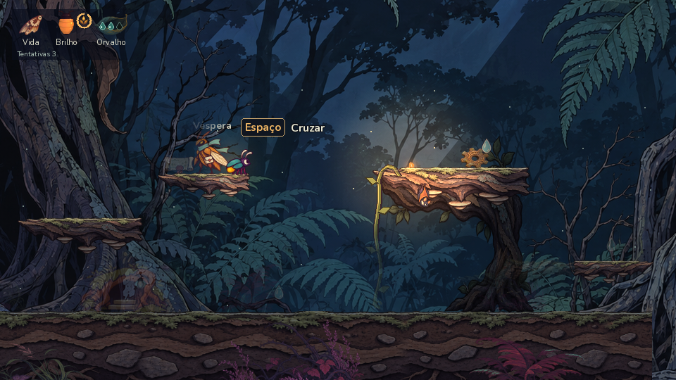

# Miopia — A última luz da mata

Lume é um vaga-lume míope numa floresta em seca. De perto, ele enxerga o galho em que pisa. Para descobrir o que o espera do outro lado, pode lançar a própria luz. A mesma fagulha que revela um pouso também atrai predadores. Esse é o ponto de partida deste metroidvania 2D feito em Python e Pygame CE.



[Assistir à abertura jogável até o primeiro morcego](docs/midia/bosque-em-jogo.mp4) · [Ver os 13 encontros em movimento](docs/midia/playtest-dos-13-encontros.mp4) · [Abrir o guia para continuar o projeto](docs/equipe/GUIA_DE_CONTINUIDADE.md)

As samambaias e o bambu cedem ao vento, a água percorre duas quedas no Córrego e as raízes da Gruta pingam sobre o remanso. [Ver os quatro cenários animados na partida](docs/midia/cenarios-vivos-em-jogo.mp4) · [Observar os detalhes com a câmera parada](docs/midia/cenarios-vivos-em-detalhe.mp4)

As quatro pinturas da campanha acompanham a câmera em Full HD. [Assistir ao playtest do Bosque, Córrego, Taquaral e Gruta](docs/midia/quatro-pinturas-em-jogo.mp4) · [Comparar os contornos em tamanho real](docs/midia/quatro-pinturas-antes-e-depois.png)

## Jogar

A partida, os menus e o mapa são renderizados em **1920 × 1080**. F11 alterna janela e tela cheia. Em telas Retina, a janela pode ocupar 960 × 540 pontos e usar os 1920 × 1080 pixels físicos. [Comparar o detalhe da pintura e da interface](docs/midia/bosque-detalhe-1080p.png)

Instale Python 3.10 a 3.14 e baixe ou clone este repositório. Na pasta do jogo, abra **Jogar Miopia.command** no macOS, **rodar.bat** no Windows ou execute **./rodar.sh** no Linux. A primeira abertura pode usar a internet para instalar o Pygame CE. Se preferir usar o terminal, estes comandos funcionam no macOS e no Linux.

```sh
python3 -m venv .venv
.venv/bin/python -m pip install -r requirements.txt
.venv/bin/python -m src.main
```

No Windows, use `py -3.12 -m venv .venv` com o Python 3.12 e substitua `.venv/bin/python` por `.venv\Scripts\python.exe`. Escolha **História** para começar no Bosque ou **Campo de testes** para entrar diretamente num encontro. O jogo salva o progresso localmente em SQLite.

## Primeiros comandos

| Ação | Teclado padrão |
|---|---|
| Andar | A / D ou setas |
| Pular, bater as asas no ar e planar na queda | Espaço, segundo toque e manter pressionado |
| Abaixar ou atravessar um apoio que permite descida | S ou S + Espaço |
| Deslizar no chão na direção do olhar | Shift |
| Corte rápido e golpe pesado | J e L |
| Clarear os arredores | K |
| Lançar uma fagulha na direção do olhar | G |
| Conversar, ler ou usar um mecanismo | E |
| Abrir o mapa e o diário | M ou Tab |

Em **Ajustes** você pode remapear os comandos, ampliar o texto e suavizar clarões. Se você já usava G para outra ação na S40, essa ação continua em G. As dicas mostram a tecla livre que o jogo atribuiu à fagulha.

No galho de Véspera, observe o lampejo da vigia e vire Lume para o pouso. A fagulha sai do abdômen de Lume em linha reta. A luz percorre a folhagem e se fixa no galho por sete segundos. O estalo de pouso vem do lado onde ela tocou. [Ver a mudança no lançamento](docs/midia/fagulha-antes-e-depois.mp4)

## Continuar o desenvolvimento

A campanha atravessa o Bosque das Samambaias, o Córrego Fundo, o Taquaral e a Gruta da Figueira. O guia reúne as mudanças desde a S40, as fontes da arte, as bibliotecas, os playtests e o próximo trecho sugerido para a equipe.

- [Guia de continuidade e roteiro de playtest](docs/equipe/GUIA_DE_CONTINUIDADE.md)
- [Cenário, esquiva e primeiro combate do Bosque](docs/arte/ESTUDO_DO_BOSQUE.md)
- [Bibliotecas, editores e instalação](docs/equipe/BIBLIOTECAS.md)
- [Folhas de produção dos inimigos](docs/arte/fontes) e [comparação feita na partida](docs/midia/antes-e-agora-na-partida.png)
- [Histórico das versões Git da equipe](docs/equipe/VERSOES.md)
- [Histórico de desenvolvimento](docs/equipe/HISTORICO.md) e [plano da equipe](docs/equipe/PLANO.md)

Para executar os testes no macOS ou Linux, instale as dependências de desenvolvimento e use o executor do projeto. Ele cria um perfil descartável e usa vídeo e áudio virtuais.

```sh
.venv/bin/python -m pip install -r requirements-dev.txt
./qa.sh
```

## Créditos

Projeto A3 da Universidade São Judas Tadeu. Equipe de desenvolvimento: Otávio Araújo Aredes Guedes, Caio Vidotte Vrech Sousa, Tiago Ribeiro Gomes, Thierry Henry Rocha da Silva, Victor Bersane Jasaitis e Iago Robert da Silva Andrade, conforme a tela de créditos do jogo. A equipe registra a origem das ilustrações geradas para esta revisão, os materiais herdados e as licenças das fontes nos arquivos de procedência. [Arte desta revisão](docs/arte/ORIGEM.md) · [Materiais da base acadêmica](docs/s00-origens.md) · [Licenças das fontes](assets/fontes)
