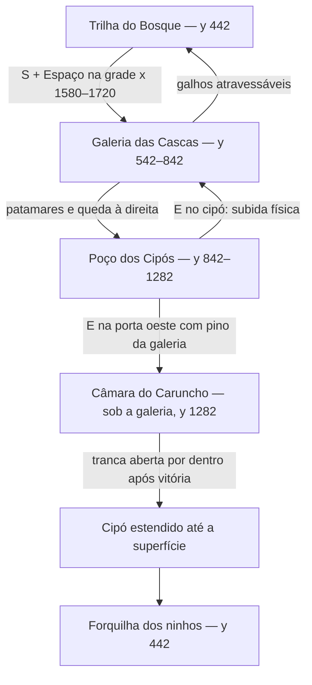

# S06 — raízes contínuas do Bosque e reservas de viagem

Rodada autorizada por Thierry. Aceites humanos permanecem abertos.

| Cartão | Estado técnico | Arquivos e evidência |
|---|---|---|
| W01 | Grafo definido | Trilha → Galeria das Cascas → Poço dos Cipós → Câmara do Caruncho. Retorno pelo cipó ou pela galeria. Mesmo bioma/coordenadas. |
| W02 | Implementado | raizes_bosque/travessia/paisagem: S+Espaço pela grade real, câmera e descoberta em profundidade; sem troca de mapa. Percurso completo validado por comandos. |
| W03 | Implementado | Cipó sobe a 265 px/s do fundo ao ombro da galeria. Após soltar o nó no viveiro, sobe à forquilha na superfície. Volta sem vencer também validada. |
| W04 | Implementado | Pino físico da galeria destrava a porta oeste da câmara; tranca protege rota opcional com perigo e recompensa. Atalho aberto por dentro. |
| W05 | Implementado | arte_raizes/paisagem: raízes, galhos e grade usam limites da colisão; peças próprias desenhadas pelo jogo. Riscos apontam até o pino. |
| W06 | Integrado | Cobra e morcego patrulham a galeria com os repertórios S04, distintos do Caruncho abaixo. |
| W07 | Protótipo jogável | Caruncho do Viveiro reaproveita vinte sequências/cinco famílias do besouro; 22 PV, resistência a interrupção, duas fases, pedido e recibo persistentes. |
| I03 | Implementado | recursos/narrativa/travessia/main: marcos guardam retorno sem curar; abrigo tem uma reserva por bioma; bálsamos limitados, excedentes preservados e save sem recarga de luz gratuita. |

## W01 — grafo antes da arte

A região nova é opcional. A cunha principal da forquilha e a arena da Asa
continuam no caminho da história. A peça da porta inferior é outro objeto,
com nome e desenho próprios. O Corte antigo permanece acessível para não
invalidar seus saves; não é usado como entrada da nova região contínua.

O poço tem uma diferença de 440 px entre o fundo e o ombro. Paredes lisas
não dão impulso e não há uma escada de galhos que torne o cipó redundante.
Mesmo sem vencer o Caruncho, é possível subir ao ombro e voltar pela galeria.
Após abrir o atalho, a mesma corda percorre todo o eixo até a superfície.

Reservar e concluir um cartão por vez. Testes usam perfil temporário.
Distribuição S05 e ZIP anterior devem ser preservados antes de entregar.

## Mundo e orientação

O Bosque mantém largura de 4.720 px e passa a ter altura de 1.400 px.
A galeria vai de x 1474 a 2110; o poço ocupa x 2110–2540; a câmara fica
abaixo da galeria, x 1474–2080. O fundo está em y 1282, 840 px sob a trilha.
Não há troca de instância ou atribuição de posição na travessia nova.
S + Espaço atravessa as grades; galhos permitem saltar de baixo para cima.

O pino de casca está no segundo galho alto da galeria. Há uma placa com duas
setas e um sulco visível localmente. Sua posição não aparece antecipadamente
no mapa. O poço usa raízes lisas, sem impulso de parede. A saída do cipó tem
uma raiz amarrada, erguida ao soltar o nó no viveiro. Todos os estados físicos
persistem como flags da História. Salvar no subsolo retoma no marco seguro,
preservando progresso, energia, descoberta e equipamentos.

A placa de Mimo aceita o pedido A reserva do berçário. Em M → direita,
ele aparece com etapa e recompensa. Derrotar o Caruncho deixa um âmbar físico
no fundo da câmara. Mimo o recebe no abrigo, entrega a Ampola do berçário e
uma carga de bálsamo, uma única vez. A ampola amplia a capacidade de 2 para 3.
O mapa conserva células de 24 px e oclusão do S04. Nomes abreviados só aparecem
depois de visitar e enxergar a parte correspondente da sala.

## Combate da rota opcional

O Caruncho utiliza Habitante e o repertório de besouro, em corpo maior.
Possui 22 PV e duas fases. Ao passar de metade da vida, recua por 0,65 s e
muda o ritmo de 1,12 para 1,26. Golpes leves causam dano quando a guarda
permite, mas não o interrompem; golpes pesados só renovam a interrupção
após 1,2 s. A mira de cada ataque continua fixa após o aviso.
Tanino, terceiro corte, golpe descendente e ataque pelas costas conservam
suas utilidades. Não é um novo conjunto de vinte animações nem um quinto
guardião obrigatório da história. Sua música reutiliza o tema autoral do
Casco; volta ao ambiente ao sair da câmara ou vencer.

Morte recompõe vida/fase do mini-chefe ainda ativo. Depois da vitória,
ele não reaparece após carregar, e âmbar/atalho/recibo não duplicam.

## I03 — cura e salvamento

- Marcos do ramal e da arena guardam a volta e não curam na História. Suas
  posições permanecem em 1848 e 3660; eles são desenhados como sinais de
  retorno, sem camas. O único abrigo com provisões fica no início do bioma.
- Cada abrigo possui uma reserva de uso único por bioma: enche a luz e a
  bolsa de bálsamos. Luz e bolsa já cheias não gastam essa reserva.
- A bolsa carrega dois bálsamos, ou três com a ampola. Cada uso recupera 35
  de luz. Cargas excedentes vão ao abrigo, inclusive na migração de saves
  antigos; não são descartadas. Retirá-las consome esse estoque finito e
  não altera a energia atual. A quantidade aparece no diário.
- Marcos, ralo e janela do Corte antigo não curam por interação repetida.
  O auxílio mínimo de 32 de luz para destravar o ralo obrigatório foi mantido.
- A raiz principal restaurada continua recuperando luz como recompensa de
  progresso. Orvalho continua sendo coleta única, sem farm de reaparecimento.
- A luz atual entra no save e no autosave. Carregar uma partida viva não a
  reabastece; após morte, voltar ao marco continua custando uma fagulha e
  restaura a luz. Saves antigos sem esse campo continuam válidos.
- Duelo da aranha e Oficina mantêm recuperação livre para ensaio. O Infinito
  preserva sua regra de luz nos marcos e sua economia de tempo.

O autosave compara a cartografia somente na janela de 0,65 s, em vez de
reconstruir a assinatura inteira a cada quadro. Dano também aciona salvamento
mesmo sem mudança de posição. Replays estritos precisam de nova gravação S06.

## Validação e teste humano

171 testes passaram no código, incluindo campanha completa e duas voltas
do Infinito. Os dez novos verificam ida/volta por controles, cipó necessário,
retorno sem vitória, porta/pino, exploração, morte, recibo, cura, excedentes,
energia salva, save antigo e autosave. Em um teste antigo, a posição usada
para simular queda passou a fazer parte da galeria; a queda agora é exercitada
em outro vão, preservando o critério de morte e retorno.

Campo de testes → Raízes do Bosque abre a entrada. E lê a placa; S + Espaço
na grade à direita desce. O ensaio retira as três patrulhas antigas da trilha
próxima para focar na região nova. A História mantém essas patrulhas.
Caruncho do Viveiro abre um ensaio direto no fundo do poço. Ambos começam
com dois bálsamos e não gravam na campanha. Há 18 ensaios ao todo.

Capturas de revisão em capturas/s06_*.png. Medição local de CPU/desenho em
desempenho-S06.json inclui galeria, poço e Caruncho. SDL dummy, 960×540,
sem espera de monitor; os números não comprovam FPS no notebook real.
O pacote final será extraído, confrontado com a fonte e testado novamente.

Aceites humanos abertos: composição da floresta, clareza do pino e do cipó,
verticalidade, retorno, duração/dificuldade do Caruncho, ritmo das provisões
e desempenho real. Nenhum teste automatizado aprova esses critérios.
Não foram adicionados downloads nem mídia externa: cenário novo é desenho
do jogo, e o Caruncho reaproveita a arte existente. Pendências comerciais
herdadas permanecem em docs/s00-origens.md.

## Continuidade

S07 começa por N01/N02 e pelo primeiro vaga-lume resgatável N03. B06 poderá
então integrar esse resgate ao clímax. C06 continua aguardando o parecer das
armas C05 e da economia I03; nenhuma segunda barra foi acrescentada sem teste.
A integração da agulha à campanha ainda não foi feita. O S06 não adiciona
uma nova região completa de 10–15 minutos nem pós-jogo: esses cartões são S07.
